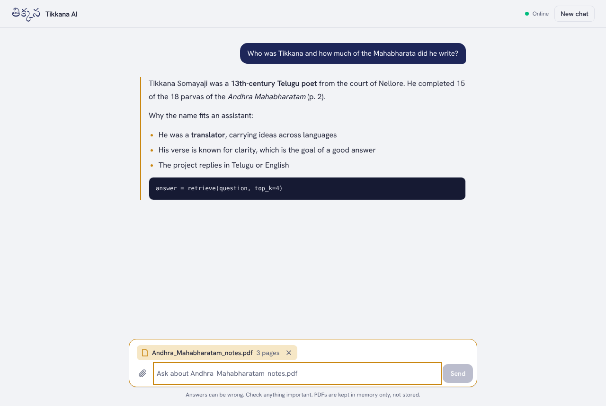

# Tikkana AI

A conversational AI assistant you can also hand a PDF to. Attach a document and Tikkana answers from it, citing the pages it used. It replies in English or Telugu.

The name comes from Tikkana Somayaji, the 13th-century poet who rendered most of the Mahabharata into Telugu — a translator, which is most of what a good assistant does.



## What it does

- **Streaming chat** with conversation memory (last 20 turns), rendered as Markdown with code blocks, lists and tables.
- **Chat with your PDF.** Uploads are split into overlapping chunks, embedded with OpenAI embeddings, and searched by cosine similarity. The top matches go to the model with page numbers so answers can cite them.
- **Telugu-aware.** Ask in Telugu, get Telugu back.
- **Light and dark themes**, responsive down to phone width, keyboard accessible, and history kept in the browser across refreshes.

## Architecture

```
Next.js 16 (React 19, Tailwind 4)            FastAPI (Python 3.12)
┌──────────────────────────────┐   HTTPS   ┌────────────────────────────────────────┐
│ Chat UI, streaming reader,    │ ────────▶ │ POST /upload  PDF → text → chunks →     │
│ PDF attach, Markdown render   │           │               embeddings → in-memory    │
└──────────────────────────────┘ ◀──────── │               vector store (LRU)        │
          Vercel                  text      │ POST /chat    retrieve top-k chunks →   │
                                  stream    │               OpenAI chat (streamed)    │
                                            │ GET  /health                            │
                                            └────────────────────────────────────────┘
                                                          Render (Docker)
```

```
backend/
  app/main.py          FastAPI app, CORS, routers
  app/routers/chat.py  streaming chat, retrieval-augmented when a doc is attached
  app/routers/upload.py PDF validation, extraction, chunking, embedding
  app/documents.py     pdfplumber/pypdf extraction, chunker, NumPy vector store
  app/llm.py           OpenAI client wrapper (swappable in tests)
  tests/               pytest suite with a fake LLM, no API key needed
frontend/
  components/Chat.tsx  the whole chat experience
  lib/api.ts           typed API client with streaming
```

## Run locally

**Backend**

```bash
cd backend
python -m venv .venv && source .venv/bin/activate
pip install -r requirements-dev.txt
cp .env.example .env        # add your OPENAI_API_KEY
uvicorn app.main:app --reload
python -m pytest            # 8 tests, runs offline
```

**Frontend**

```bash
cd frontend
npm install
cp .env.example .env.local  # NEXT_PUBLIC_API_URL=http://localhost:8000
npm run dev                 # http://localhost:3000
```

## Deploy

1. **Backend on Render** — [](https://render.com/deploy?repo=https://github.com/charanreddy9866/Tikkana-AI)
   Render reads `render.yaml`, builds `backend/Dockerfile`, and asks for `OPENAI_API_KEY`. Copy the service URL when it's live (e.g. `https://tikkana-api.onrender.com`).
2. **Frontend on Vercel** — [](https://vercel.com/new/clone?repository-url=https://github.com/charanreddy9866/Tikkana-AI&root-directory=frontend&env=NEXT_PUBLIC_API_URL&envDescription=URL%20of%20the%20Tikkana%20backend)
   Set `NEXT_PUBLIC_API_URL` to the Render URL. Any `*.vercel.app` domain is already allowed by the backend's CORS; add a custom domain to `ALLOWED_ORIGINS` on Render if you use one.

Render's free tier sleeps after inactivity. The UI shows "Waking up the server" and keeps checking for up to a minute.

## Configuration

| Variable | Where | Default |
| --- | --- | --- |
| `OPENAI_API_KEY` | backend | required |
| `OPENAI_MODEL` | backend | `gpt-4o-mini` |
| `OPENAI_EMBEDDING_MODEL` | backend | `text-embedding-3-small` |
| `ALLOWED_ORIGINS` | backend | `http://localhost:3000` (plus `*.vercel.app`) |
| `MAX_UPLOAD_MB` | backend | `10` |
| `NEXT_PUBLIC_API_URL` | frontend | `http://localhost:8000` |

## Limits and next steps

- Documents live in memory, so they're cleared when the server restarts. A persistent vector store (pgvector or Chroma) is the next step.
- Scanned PDFs without a text layer aren't supported yet; OCR would fix that.

---

Built by [Charan Reddy Katta](https://github.com/charanreddy9866).
